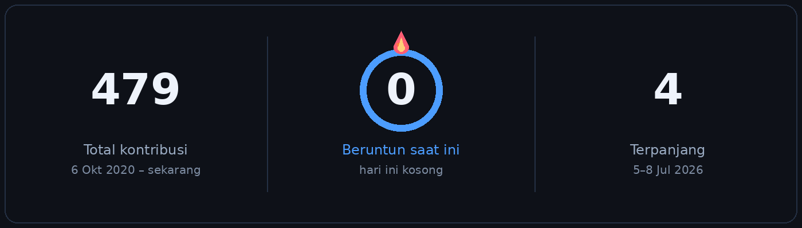

<div align="center">


<a href="https://andrarizal.github.io/AndraRizal/">
  
</a>

<br/>

<a href="https://andrarizal.github.io/AndraRizal/"></a>


</div>


## Tentang

<div align="center">

Senior fullstack developer di Yogyakarta. Koordinator Data & Informasi di RSU Mitra Paramedika.

</div>

```js
const andra = {
  name: "Andra Aulia Rizaldy, S.Kom.",
  role: "Senior Fullstack Developer",
  title: "Coordinator of Data & Information",
  workplace: "RSU Mitra Paramedika",
  from: "Yogyakarta, Indonesia",
  stack: ["Node.js", "NestJS", "Laravel", "Golang", "Next.js", "PostgreSQL"],
  focus: ["SIMRS", "REST API", "DevOps"],
  education: "Software Engineering, Institut Teknologi Telkom Purwokerto · IPK 3.91, cum laude",
  motto: "Keep Learning, Keep Moving",
  portfolio: "https://andrarizal.github.io/AndraRizal/",
};
```

- Lebih dari lima tahun membangun perangkat lunak, termasuk lebih dari tiga tahun memimpin SIMRS rumah sakit
- Backend **Node.js** (Express, NestJS), **Laravel**, dan **Golang**; frontend **Next.js**, **React**, dan **Vue**
- Integrasi Kementerian Kesehatan, Satu Sehat, dan bridging BPJS
- S1 Software Engineering, Institut Teknologi Telkom Purwokerto, IPK 3.91, cum laude
- Situs: [andrarizal.github.io/AndraRizal](https://andrarizal.github.io/AndraRizal/)
- Gambar: [Rekam medis berjalan](https://andrarizal.github.io/AndraRizal/rekam-medis.html)


## Keahlian

<div align="center">

**Frontend**


**Backend**


**Data dan DevOps**


</div>


## Pengalaman

**Koordinator Data & Informasi** · RSU Mitra Paramedika, Yogyakarta · 06/2023–sekarang

- Memimpin tim Data & Informasi dan merancang SIMRS dengan Laravel, Next.js, dan MySQL
- HRIS serta inventaris dengan Node.js (Express, NestJS), PostgreSQL, Redis, dan Firebase
- Microservice Golang untuk notifikasi, Satu Sehat, dan kepegawaian
- Integrasi Kemenkes, Satu Sehat, dan BPJS; deploy dengan Docker, Kubernetes, GitLab CI/CD, dan AWS

**Backend, proyek lepas** — perpustakaan dan kasir (Golang), klinik (Java)

**Sebelumnya** — magang fullstack di BINAR dan backend Laravel di Bisa Tani (2022), asisten lab pemrograman web di IT Telkom Purwokerto, lalu fullstack di Bahira Studio, Bikermart Indonesia, dan Sari Glass Warehouse.


## GitHub

<div align="center">


<br/>



</div>


## Kontribusi

<div align="center">
<picture>
  <source media="(prefers-color-scheme: dark)" srcset="https://raw.githubusercontent.com/Andrarizal/AndraRizal/main/assets/snake-dark.svg?v=3" />
  <source media="(prefers-color-scheme: light)" srcset="https://raw.githubusercontent.com/Andrarizal/AndraRizal/main/assets/snake.svg?v=3" />
  
</picture>
</div>


## Kontak

<div align="center">

<a href="mailto:andrarizal2000@gmail.com"></a>
<a href="tel:+6287833254882"></a>
<a href="https://www.linkedin.com/in/andra-aulia-rizaldy-939404232/"></a>
<a href="https://www.youtube.com/channel/UCnYAJAK2o31-_l3akpcC6tQ"></a>
<a href="https://instagram.com/andrarizal787"></a>
<a href="https://github.com/Andrarizal"></a>

<br/><br/>

*Keep Learning, Keep Moving.*

</div>
