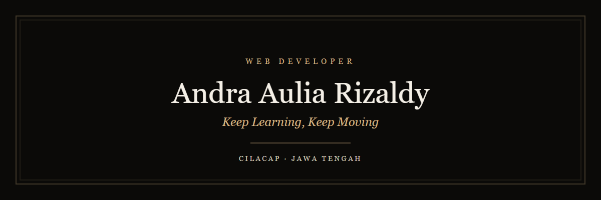
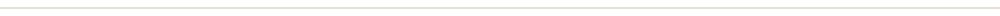
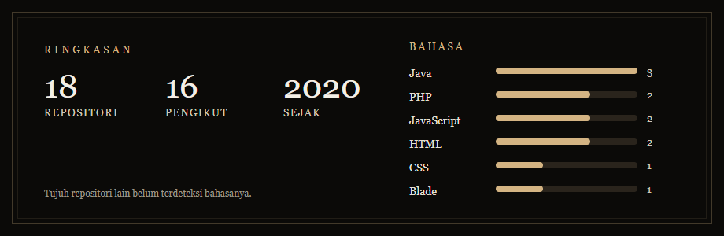

<div align="center">



<a href="https://andrarizal.github.io/AndraRizal/">
  
</a>

<br/>

<a href="https://andrarizal.github.io/AndraRizal/"></a>


</div>



## Tentang

<div align="center">

Web developer dari Cilacap. Aplikasi web fullstack, REST API, dan kode yang rapi.

</div>

```js
const andra = {
  name: "Andra Aulia Rizaldy",
  role: "Web Developer",
  from: "Cilacap, Jawa Tengah",
  stack: ["Laravel", "Express.js", "React", "TypeScript", "MySQL"],
  focus: ["Fullstack Web", "REST API", "Clean & Scalable Code"],
  currentlyLearning: ["TypeScript", "System Design"],
  openTo: ["Collaboration", "Open Source", "Freelance"],
  motto: "Keep Learning, Keep Moving",
  portfolio: "https://andrarizal.github.io/AndraRizal/",
};
```

- Membangun aplikasi web dengan **Laravel**, **Express.js**, dan **React**
- Sedang mendalami **TypeScript** dan **system design**
- Terbuka untuk kolaborasi, open source, dan freelance
- Situs: [andrarizal.github.io/AndraRizal](https://andrarizal.github.io/AndraRizal/) · tampilan ada di folder `docs/`


## Keahlian

<div align="center">

**Frontend**


**Backend dan database**


**Bahasa lain**


</div>


## GitHub

<div align="center">



<br/>


</div>


## Kontribusi

<div align="center">
<picture>
  <source media="(prefers-color-scheme: dark)" srcset="https://raw.githubusercontent.com/Andrarizal/AndraRizal/output/github-snake-dark.svg" />
  <source media="(prefers-color-scheme: light)" srcset="https://raw.githubusercontent.com/Andrarizal/AndraRizal/output/github-snake.svg" />
  
</picture>
</div>


## Kontak

<div align="center">

<a href="https://www.linkedin.com/in/andra-aulia-rizaldy-939404232/"></a>
<a href="https://www.youtube.com/channel/UCnYAJAK2o31-_l3akpcC6tQ"></a>
<a href="https://instagram.com/andrarizal787"></a>
<a href="https://github.com/Andrarizal"></a>

<br/><br/>

*Keep Learning, Keep Moving.*

</div>
